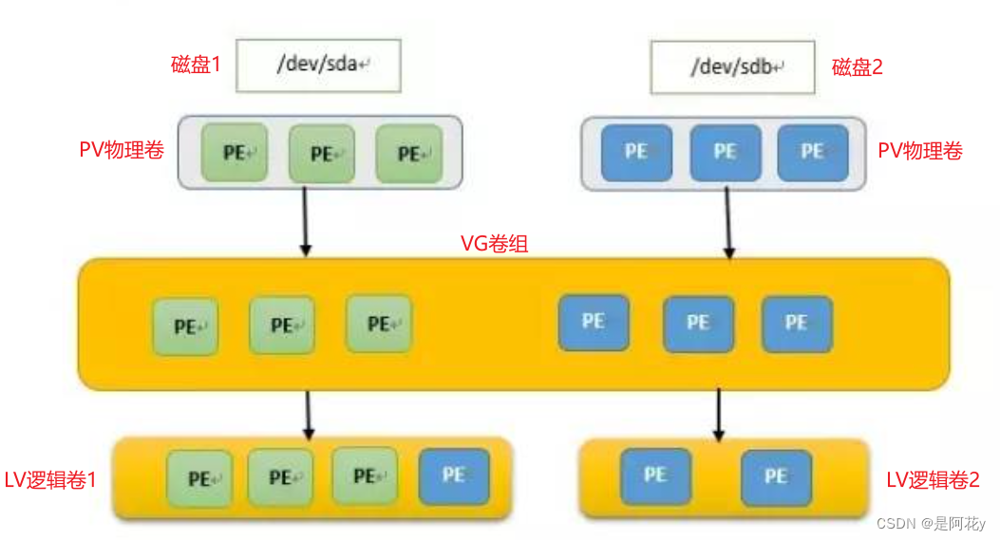

[TOC]


## Linux挂载相关

#### 1 基本概念

Linux中的根目录以外的分区要想被访问，需要将其“关联”到根目录下的某个目录来实现，这种关联操作就是“挂载”，这个目录就是“挂载点”，解除次关联关系的过程称之为“卸载”。

文件系统：采用单一目录树结构，以 */* 为根，将普通文件、目录、设备、进程等统一抽象为“文件”。内核通过 VFS（虚拟文件系统） 为 ext4、XFS、Btrfs 等不同类型文件系统提供统一接口。

#### 2 常用命令

```shell
mount [选项] 设备 挂载点

umount 挂载点
umount -l /mnt/data  # 延迟卸载
umount -f /mnt/data  # 强制卸载

df -h  # 显示已挂载文件系统的使用情况

lsblk  # 显示设备和挂载点
fdisk  #命令行工具，适用于创建主分区和扩展分区，支持MBR分区表
fuser  #查看正在访问指定文件系统的进程
```

#### 3 挂载选项

```shell
    -t vsftype #指定要挂载的设备上的文件系统类型

    -r		   #readonly，只读挂载

    -w         #read and write, 读写挂载

    -n         #不更新/etc/mtab

    -a         #自动挂载所有支持自动挂载的设备；(定义在了/etc/fstab文件中，且挂载                选项中有“自动挂载”功能)

    -L 'LABEL' #以卷标指定挂载设备

    -U 'UUID'  #以UUID指定要挂载的设备

    -B, --bind #绑定目录到另一个目录上
```

```shell
 -o options

      async 			    #异步模式

      sync                  #同步模式

      atime/noatime         #包含目录和文件

      diratime/nodiratime   #目录的访问时间戳

      auto/noauto           #是否支持自动挂载

      exec/noexec           #是否支持将文件系统上应用程序运行为进程

      dev/nodev             #是否支持在此文件系统上使用设备文件

      suid/nosuid           #是否支持在此文件系统上使用特殊权限

      remount               #重新挂载

      ro                    #只读

      rw                    #读写

      user/nouser           #是否允许普通用户挂载此设备

      acl                   #启用此文件系统上的acl功能

选项可多个同时使用，彼此使用逗号分隔

默认挂载选项：defaults：rw, suid, dev, exec, auto, nouser, and async
```

#### 4 /etc/fstab 配置

```shell
设备					   挂载点    文件系统类型  挂载选项       dump  fsck
/dev/mapper/centos-root /        xfs        defaults        0     0
UUID= xxx 				/boot    xfs        defaults        0     0
/dev/mapper/centos-home /home    xfs        defaults        0     0
/dev/mapper/centos-swap swap     swap       defaults        0     0

dump #备份  0：不做备份   1：每天转储     2：每隔一天转储
fsck #检查  0：不自检     1：首先自检；一般只有rootfs才用1；

```

 `/etc/fstab`文件的作用: 

记录了计算机上硬盘分区的相关信息，启动 Linux 的时候，检查分区的 fsck 命令，和挂载分区的 mount 命令，都需要 fstab 中的信息，来正确的检查和挂载硬盘。 

/etc/mtab文件的作用： 

记载的是现在系统已经装载的文件系统，包括操作系统建立的虚拟文件等，每当 mount 挂载分区、umount 卸载分区，都会动态更新 mtab，mtab 总是保持着当前系统中已挂载的分区信息，fdisk、df 这类程序，必须要读取 mtab 文件，才能获得当前系统中的分区挂载情况。

##  linux分区基础知识，linux主要目录的功能，传统分区与lvm

#### 1 linux分区基础知识

##### 1.1 物理磁盘与逻辑分区

物理磁盘：直接连接到计算机的硬件设备

在 Linux 中，磁盘通过设备文件表示，如/dev/sd[a-z]：SATA/SCSI 磁盘；/dev/nvme0n[0-9]：NVMe 磁盘，U盘也通过sd，云主机或某些虚拟机使用vd

分区：物理磁盘的划分，每个分区被视为独立的“逻辑磁盘”。分区通过磁盘设备文件加数字后缀表示，例如 /dev/sda1

##### 1.2 分区表：MBR 与 GPT

分区表是磁盘的“目录”，记录分区的数量、大小、位置等信息。Linux 支持两种主流分区表：

MBR（主引导记录，Master Boot Record）

结构：包含引导代码、分区表、结束标志

最多支持 4 个主分区，若需更多分区，需将 1 个主分区设为扩展分区，再在其中创建逻辑分区，单盘最大支持 2TB 容量（因使用 32 位扇区地址）

GPT（GUID 分区表，GUID Partition Table）

结构：使用 GUID（全局唯一标识符）标识分区类型，支持备份分区表

最多支持 128 个分区（Windows 默认），理论上无上限；

支持单盘容量 > 2TB（使用 64 位扇区地址，最大支持 8ZiB）；

内置校验机制（CRC32 校验和），降低分区表损坏风险；

支持 UEFI 启动（现代主板标配）

##### 1.3 分区类型与作用

EFI 系统分区（ESP）：
GPT 分区表专用，存放 UEFI 引导程序（如 GRUB），需格式化为 FAT32，大小通常为 200MB~512MB，挂载点为` /boot/efi`。

引导分区（`/boot`）：
存放 Linux 内核、initramfs 等启动文件，避免因 / 分区加密导致无法引导。

根分区（`/`）：
系统根目录，存放操作系统核心文件

家目录分区（`/home`）：
存放用户数据（如文档、配置），独立分区可避免重装系统时数据丢失。大小根据用户数据量分配。

交换分区（Swap）：
充当“虚拟内存”，当物理内存不足时，系统将部分数据写入交换分区。

##### 1.4 主流文件系统类型

| 文件系统  | 特点                                   | 最大文件大小 | 最大分区大小 | 适用场景                           |
| --------- | -------------------------------------- | ------------ | ------------ | ---------------------------------- |
| **ext4**  | 成熟稳定、兼容性好、支持日志和延迟分配 | 16TB         | 1EB          | 系统分区（/、/home）、通用场景     |
| **XFS**   | 高性能（大文件读写）、可动态扩容       | 8EB          | 8EB          | 服务器数据分区、视频存储           |
| **Btrfs** | 支持快照、RAID、在线修复，功能丰富     | 16EB         | 16EB         | 高级存储需求（需手动启用部分特性） |
| **FAT32** | 跨平台（Windows/Linux/macOS）兼容      | 4GB          | 2TB          | EFI 分区、U盘（小文件）            |
| **NTFS**  | Windows 主流文件系统，Linux 只读支持   | 16EB         | 256TB        | 临时挂载 Windows 磁盘              |
| **Swap**  | 无实际文件系统，用于内存交换           | -            | -            | 交换分区                           |

##### 1.5 分区工具

`fdis`k 与 `gdisk`：分区表管理

`fdisk`：适用于 MBR 分区表

`gdisk`适用于 GPT 分区表

```shell
gdisk /dev/sda  # 操作磁盘 /dev/sda
```

进入交互模式后，常用命令

```shell
o #创建新 GPT 分区表（会清空数据！谨慎操作）。
n #新建分区（输入分区号、起始扇区、大小，默认用剩余空间）。
t #修改分区类型（如设为 EFI 分区：输入类型代码 ef00）。
p #查看分区表。
w #保存并退出（此步执行后才会写入磁盘）。
```

`parted`：高级分区工具

支持 MBR/GPT 分区表，可直接调整分区大小

```shell
parted /dev/sdb                       # 操作磁盘 /dev/sdb
(parted) mklabel gpt                  # 创建 GPT 分区表
(parted) mkpart primary ext4 0% 50%   # 从 0% 到 50% 创建 ext4 主分区
(parted) mkpart primary xfs 50% 100%  # 剩余空间创建 xfs 分区
(parted) print                        # 查看分区结果
(parted) quit                         # 退出
```

mkfs：格式化分区

用于将分区格式化为指定文件系统：

```shell
mkfs.ext4 /dev/sda3      # 格式化为 ext4
mkfs.xfs /dev/sda4       # 格式化为 xfs
mkfs.fat -F32 /dev/sda1  # 格式化为 FAT32（EFI 分区）
mkswap /dev/sda2         # 初始化交换分区
```

#### 2 linux主要目录的功能

在 Linux 系统中，所有内容都是以文件的形式保存和管理的，即「一切皆文件」。普通文件是文件，目录是文件，硬件设备是文件，网络通信等资源也都是文件。

| /bin   |        二进制可执行命令。该目录下存放着普通用户的命令        |
| ------ | :----------------------------------------------------------: |
| /boot  |                     启动Linux的核心文件                      |
| /dev   |               系统的设备文件，即设备的驱动程序               |
| /etc   |               系统所有的配置文件都在这个目录中               |
| /home  |                       用户主目录的基点                       |
| /lib   |                 存放着和系统运行相关的库文件                 |
| /lib64 |                   主要存放64位版本的库文件                   |
| /media |              存放着可移除的设备，比如软盘，光盘              |
| /mnt   | 用于临时挂载外部设备或文件系统的标准目录，主要用于手动挂载操作。 |
| /opt   |  (option : 自由选择)主要给源码安装软件时选择的安装目录位置   |
| /proc  |                  存放着用户与内核的交互信息                  |
| /root  |                        超级用户的目录                        |
| /run   |             存储各种运行时数据的地方，重启时清除             |
| /sbin  |       系统的管理命令，这里存放的是系统管理员使用的程序       |
| /srv   |              系统启动服务时可以访问的数据库目录              |
| /sys   |                         管理设备文件                         |
| /tmp   |                   临时文件，重启后自动清空                   |
| /var   |          某些大文件的溢出区，比如各种服务的日志文件          |
| /usr   |               存放应用程序和文件               |

#### 3 传统分区与lvm

##### 3.1 传统分区与lvm的区别

简单来说，传统分区是静态的、物理的划分方式，而LVM是动态的、逻辑的卷管理层。

| 特性         | 传统分区 (Standard Partition)      | LVM (Logical Volume Manager)               |
| ------------ | ---------------------------------- | ------------------------------------------ |
| **抽象层**   | 直接在物理硬盘上划分区域。         | 在物理硬盘和文件系统之间增加了一个抽象层。 |
| **层级结构** | 硬盘 -> 分区 (sda1, sda2...)       | 物理卷(PV) -> 卷组(VG) -> 逻辑卷(LV)       |
| **灵活性**   | 空间大小固定，调整非常困难。       | 空间可以动态调整                           |
| **跨磁盘**   | 一个分区只能存在于一块物理硬盘上。 | 一个逻辑卷可以跨越多个物理硬盘。           |

磁盘利用率：

传统分区： 容易产生“碎片化”的空闲空间。例如，硬盘开头有 10G 空闲，结尾有 10G 空闲，无法直接创建一个 20G 的连续分区。

LVM： 它将物理磁盘划分为小的 PE（Physical Extents，物理块）。LV 可以由散落在不同磁盘、不同位置的 PE 组成，能利用所有零散空间。

快照功能：

传统分区：不支持原生快照。备份通常需要拷贝整个分区的数据。

LVM： 支持快照。可以在某一时刻为逻辑卷创建一个快照，记录当时的数据状态。

性能与复杂性

传统分区： 结构简单，性能是原生的（没有中间层）。

LVM： 由于多了一个映射层，理论上会有极微小的性能损耗，实际上可以忽略不计。复杂性较高，如果 LVM 的元数据损坏，恢复数据比传统分区更麻烦。

##### 3.2 lvm工作原理

它是linux系统中磁盘管理工具，其思想是将物理磁盘和分区进行虚拟化，创建虚拟的磁盘空间，从虚拟的磁盘空间中按需分配，使用起来更灵活，更易于管理。

LVM通过3层抽象来管理存储空间，分别是物理卷PV（physical volume)、卷组VG（volume group)、逻辑卷LV（logical volume)。

PV指物理卷，初始的物理存储设备，硬盘需要创建物理卷，才能添加到LVM中的卷组中。

VG即卷组，它处于LVM中的核心位置，将多个物理卷组合成一个统一的存储结构，总容量大小为各个物理卷对应物理设备容量之和。

LV指逻辑卷，即对上面的VG进行划分，分配出来的虚拟的、灵活的逻辑空间，供操作系统使用。



## 小的安装时在check什么 大的会无法开机

安装介质完整性校验，也就是检查你当前从 /dev/sr0 启动的这个光盘/ISO 镜像有没有损坏。

安装时选择了Test this media & install，然后安装介质校验失败，安装程序认为当前 ISO/光驱介质不可验证，因此拒绝继续安装。

常见原因：ISO 不是官方原版，或者被修改过；ISO 下载不完整或已损坏； ISO 本身没有嵌入可供 checkisomd5 使用的信息

## 掩码注意事项

/24=255.255.255.0

掩码为24位时，一般只使用2-254即253个可用地址

x.x.x.255为广播地址

## 磁盘置备的三种模式

#### 1 精简置备

表示：先分配逻辑容量，但不立即占用全部物理空间

即创建一个 100GB 的磁盘，但实际只先占用已经写入的数据那部分空间

节省初始存储空间

创建速度快

#### 2 厚置备，延迟置零 

表示：一次性分配完整容量，但不立即把所有块都清零

即创建时占用全部物理空间，但真正写入某个块时，系统才去清零并写入

创建后容量已被完整预留

性能通常比精简更稳定

由于未立即清零，首次写入某些块时可能有轻微额外开销

#### 3 厚置备，置零

表示：一次性分配完整容量，并且立即把所有块都清零

占用全部物理空间

创建时间最长

首次写入性能最好、最稳定

常用于对性能要求高的场景，比如某些高性能数据库、虚拟化集群需求等

## 磁盘 分区（linux可以省略） 文件系统 文件

数据不是直接变成文件的，是先经过磁盘、分区、文件系统这些层次，最后才表现看到的文件。

磁盘 提供原始存储空间

分区 把磁盘切成更小的管理单元（可选）

文件系统 在磁盘或分区上建立组织结构

文件 是文件系统中最终呈现出来的内容

#### 1. 磁盘

linux 并不会直接拿“整块磁盘”去存文件，而是通常要先进行管理和组织。

#### 2. 分区

在传统磁盘管理里，常常会先分区，再在分区上创建文件系统

但 Linux 也可以直接在整块磁盘上创建文件系统，不一定非要先分区

#### 3. 文件系统

没有文件系统，磁盘上的数据只是零散的原始块，很难直接使用。

#### 4. 文件

文件不是凭空出现的，而是文件系统在磁盘上分配空间、记录元数据后形成的逻辑结果。

设备在 Linux 中也都被抽象成文件，备份打包的时候也不是打包一切

## 分区软件的使用

#### 1 `fdisk`的使用 

```shell
fdisk /dev/sda
```

使用选项

```shell
a #切换可引导标志，主要用于 MBR/MSDOS 分区表，告诉 BIOS 从哪个分区启动系统。
b #编辑 BSD disklabel
c #切换 DOS 兼容标志
d #删除一个分区
g #创建一个新的空 GPT 分区表
G #创建一个新的空 IRIX（SGI）分区表
l #列出已知的分区类型
m #显示此菜单
n #添加一个新分区
o #创建一个新的空 DOS 分区表
p #打印/显示分区表
q #退出且不保存更改
s #创建一个新的空 Sun disklabel
t #更改分区的系统 ID
u #更改显示/输入单位
v #校验分区表
w #将分区表写入磁盘并退出
```

示例 使用`fdisk`将空余300g空间新建为/dev/sda3分区，并将分区挂载到/data上

```shell
fdisk /dev/sda

Command (m for help): n
Partition type:
   p   primary (2 primary, 0 extended, 2 free)
   e   extended
#创建新分区

Select (default p): p
#设置为主分区

Partition number (3,4, default 3): 3
#设置分区号

First sector (1050675200-1677721599, default 1050675200):
#新分区的起始扇区
Last sector, +sectors or +size{K,M,G} \
(1050675200-1677721599, default 1677721599):
#新分区的结束扇区或大小

Command (m for help): w
#将分区表写入内核

partprobe /dev/sda
#刷新内核分区表

mkfs.ext4 /dev/sda
#创建文件系统

mkdir /data
mount /dev/sda3 /data
#挂载

df -T
#验证挂载
```

将挂载信息写入`etc/fstab`实现开机自动挂载

Last sector, +sectors or +size{K,M,G} 的输入方式

| 输入方式       | 例子       | 含义                 |
| -------------- | ---------- | -------------------- |
| 直接给结束扇区 | 1677721599 | 精确到扇区           |
| +扇区数        | +1000000   | 从起点延伸多少个扇区 |
| +大小{K,M,G}   | +100G      | 从起点延伸多少容量   |

#### 2 `gdisk`的使用

```shell
gdisk /dev/sda
```

使用`gdisk`分区时，打开 MBR 磁盘时会自动将整个磁盘转换为 GPT 分区表

使用选项

```shell
b	#将 GPT 数据备份到文件
c	#更改分区名称
d	#删除一个分区
i	#显示分区的详细信息
l	#列出已知的分区类型
n	#添加一个新分区
o	#创建一个新的空 GUID 分区表（GPT）
p	#显示分区表
q	#退出且不保存更改
r	#恢复和转换选项（仅限专家）
s	#对分区排序
t	#更改分区的类型代码
v	#校验磁盘
w	#将分区表写入磁盘并退出
x	#额外功能（仅限专家）
?	#显示此菜单
```

示例 使用`gdisk`将空余300g空间新建为/dev/sda3分区，并将分区挂载到/data上

```shell
gdisk /dev/sda

Command (? for help): n
#创建新分区

Partition number (3-128, default 3):
#创建新分区

First sector (34-1677721566, default = 1050675200) or {+-}size{KMGTP}:
#新分区的起始扇区
Last sector (1050675200-1677721566, default = 1677721566) or {+-}size{KMGTP}:
#新分区的结束扇区或大小

Hex code or GUID (L to show codes, Enter = 8300): 
#确认分区代码

Command (? for help): w
#将分区表写入内核

partprobe /dev/sda
#刷新内核分区表

mkfs.ext4 /dev/sda
#创建文件系统

mkdir /data
mount /dev/sda3 /data
#挂载

df -T
#验证挂载
```

#### 3 `parted`的使用

```shell
parted /dev/sda
```

使用选项

|                    命令                    |                             说明                             |
|:------------------------------------------:| :----------------------------------------------------------: |
|            `align-check TYPE N`            |         检查分区 N 是否符合 TYPE(min\|opt) 对齐方式          |
|              `help [COMMAND]`              |              显示通用帮助信息，或特定命令的帮助              |
|       `mklabel, mktable LABEL-TYPE`        |                创建一个新的磁盘标签（分区表）                |
|   `mkpart PART-TYPE [FS-TYPE] START END`   |                         创建一个分区                         |
|             `name NUMBER NAME`             |                  将分区 NUMBER 命名为 NAME                   |
| `print [devices\|free\|list,all \|NUMBER]` | 显示分区表、可用设备、空闲空间、所有已找到的分区，或指定的某个分区 |
|                   `quit`                   |                           退出程序                           |
|             `rescue START END`             |             恢复位于 START 和 END 之间丢失的分区             |
|          `resizepart NUMBER END`           |                    调整分区 NUMBER 的大小                    |
|                `rm NUMBER`                 |                       删除分区 NUMBER                        |
|              `select DEVICE`               |                       选择要编辑的设备                       |
|           `disk_set FLAG STATE`            |                 设置所选设备的标志为指定状态                 |
|            `disk_toggle [FLAG]`            |                 切换所选设备上标志的开关状态                 |
|          `set NUMBER FLAG STATE`           |                   设置分区的标志为指定状态                   |
|          `toggle [NUMBER [FLAG]]`          |                切换分区NUMBER上标志的开关状态                |
|                `unit UNIT`                 |                      设置默认单位为UNIT                      |
|                 `version`                  |               显示GNU Parted的版本号和版权信息               |

标志：boot, root, swap, hidden, raid, lvm,lba,hp-service,palo,prep,msftres,

bios_grub, atvrecv, diag, legacy_boot

示例 使用`parted`将空余300g空间新建为/dev/sda3分区，并将分区挂载到/data上

```shell
parted
#进入分区工具

(parted) print free
#显示空闲空间

Model: VMware Virtual disk (scsi)
Disk /dev/sda: 859GB
Sector size (logical/physical): 512B/512B
Partition Table: msdos
Disk Flags: 

Number  Start   End     Size    Type     File system  Flags
        32.3kB  1049kB  1016kB           Free Space
 1      1049kB  1075MB  1074MB  primary  xfs          boot
 2      1075MB  538GB   537GB   primary  xfs
        538GB   859GB   321GB            Free Space

Model: VMware Virtual disk (scsi)
Disk /dev/sda: 859GB
Sector size (logical/physical): 512B/512B
Partition Table: msdos
Disk Flags: 

Number  Start   End     Size    Type     File system  Flags
        32.3kB  1049kB  1016kB           Free Space
 1      1049kB  1075MB  1074MB  primary  xfs          boot
 2      1075MB  538GB   537GB   primary  xfs
        538GB   859GB   321GB            Free Space

(parted) mkpart p 
#新建primary分区

File system type?  [ext2]? xfs 
#确定文件系统

Start? 538GB                                                     
End? 100% 
#确定起始与结束扇区

(parted) align-check optimal 3
#检查3号分区对齐

(parted) print
#确认结果

(parted) quit

partprobe /dev/sda
mkfs.xfs /dev/sda3
mkdir /data
mount /dev/sda3 /data
#挂载

df -T
#验证挂载
```

注意到，使用`parted`没有写入选项，一旦更改并退出会自动将结果保存并写入硬盘，使用时要格外注意，`parted`相比另外两个使用更加简单

## 格式化的使用

将分区格式化为指定的文件系统类型

```shell
mkfs [options] [-t <type>] [fs-options] <device> [<size>]
```

使用选项

```shell
-t
#文件系统类型；如果未指定，默认使用 ext2
fs-options	
#传递给实际文件系统构建器的参数；<device>要使用的设备路径；<size>设备上要使用的块数量
-V
#--verbose解释正在执行的操作；指定-V超过一次会导致空运行（dry-run，即只显示不执行）
-V
#--version显示版本信息并退出；-V作为--version 时必须是唯一选项
-h
#--help显示此帮助文本并退出
```

```shell
mkfs -t ext4 /dev/sda3
mkfs.ext4 /dev/sda3      # 格式化为 ext4
mkfs -t xfs /dev/sd4
mkfs.xfs /dev/sda4       # 格式化为 xfs
mkswap /dev/sda2         # 初始化交换分区
```

## LVM的使用

LVM的安装

```shell
yum install -y lvm2
```

#### 1 示例

把`/dev/sdb`创建为LVM，挂载到`/data`

创建PV

```shell
pvcreate /dev/sdb
#pvcreate 硬盘或分区（可以为硬盘与分区混用，最好全为分区）
#如果已有分区表或文件系统需要进行清除后再创建PV
#wipefs 清除签名

pvs          #简要信息
pvdisplay    #详细信息
pvremove	 #删除PV
```

创建VG

```shell
vgcreate vg_data /dev/sdb
#vgcreate vg名 PV

vgs			 #简要信息
vgdisplay    #详细信息
vgremove	 #删除VG
```

创建LV

```shell
lvcreate -L 100G -n lv_data vg_data
#指定大小，选项为L

lvcreate -l 80%VG -n lv_data vg_data
#使用百分比，选项为l

lvcreate -l 100%FREE -n lv_data vg_data
#使用VG所有剩余空间，选项为l

lvs			 #简要信息
lvdisplay	 #详细信息
lvremove	 #删除VG
```

格式化并挂载

与之前操作相同

#### 2 扩容LV

先进行备份

VG有剩余空间

```shell
lvextend -L +50G /dev/vg_data/lv_data
#增加50G

lvextend -L 200G /dev/vg_data/lv_data
#增加到200G

lvextend -l +100%FREE /dev/vg_data/lv_data
#使用剩余空闲空间
```

扩容之后需要同步扩容文件系统

VG无剩余空间

 ```shell
 pvcreate /dev/sdc
 #将新硬盘加入PV
 
 vgextend vg_data /dev/sdc
 #加入现有VG
 
 扩容LV
 ```

#### 3 缩容LV

先进行备份

先缩小文件系统，后缩小LV

```shell
umount /data
#从挂载点卸载

df -T
#查看文件系统

resize2fs /dev/vg_data/lv_data 50G
#缩小文件系统到50G

lvreduce -L 50G /dev/vg_data/lv_app
#缩小LV到50G
```

在删除LVM时需要从上到下的删除，即从挂载点卸载直到删除PV

快照

```shell
lvcreate -L 10G -s -n lv_data_snap /dev/vg_data/lv_data
#创建快照（10G 快照空间）

mount -o ro /dev/vg_data/lv_app_snap /mnt/snap
#挂载快照（只读访问原数据某个时刻的状态）
```

使用选项

```shell
-L 10G	    #指定绝对大小（G/M/T）
-l 100%FREE	#使用 VG 所有剩余空间
-l 80%VG	#使用 VG 的 80%
-n lv_name	#指定 LV 名称
-s	        #创建快照
-r	        #扩容LV时同步扩容文件系统
```

```shell
wipefs [选项] <设备>
```

常用选项：

```shell
-a / --all：擦除所有检测到的签名

-t / --types <类型>：仅擦除指定类型签名（如 gpt, ext4）

-o / --offset <字节>：按偏移量擦除特定签名

-n / --no-act：演练模式，仅显示将执行的操作

-f / --force：强制擦除，即使设备挂载

-J / --json：JSON 格式输出，便于脚本解析
```

