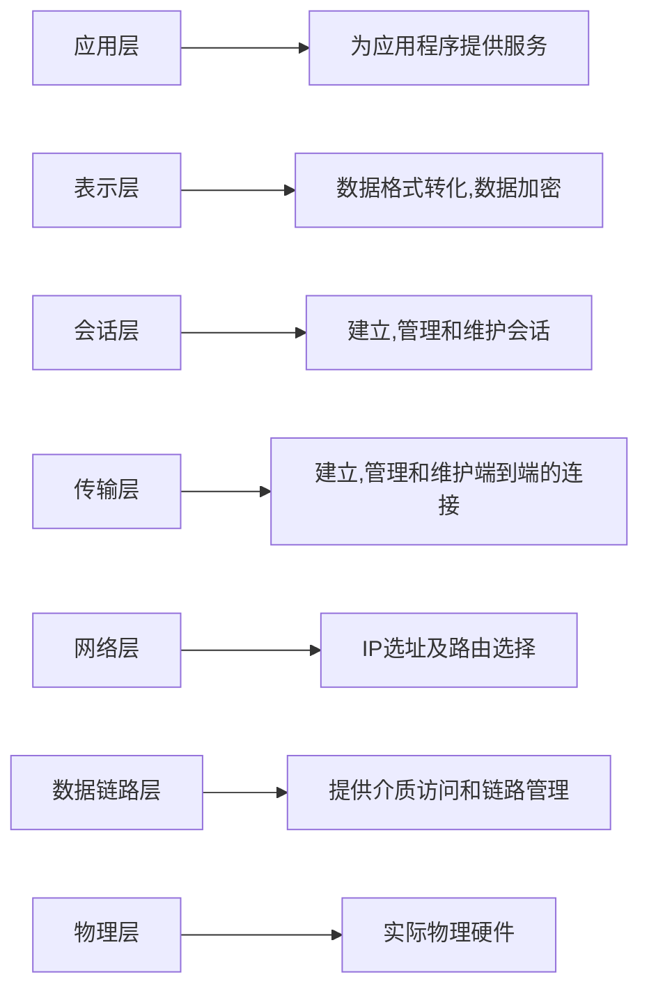

## 0、OSI七层模型

开放式系统互联（OSI）是一种概念模型，由国际标准化组织提出，一个试图使各种计算机在世界范围内互连为网络的标准框架。定义于ISO/IEC 7498-1。



## 1、centos7.9 

安装app与frontend服务器

frontend为双网卡，app为单网卡

修改配置文件将app的ip地址设置为192.168.129.2，frontend连接互联网的ip地址设置为100.100.129.100

在frontend上开启ip转发

```bash
echo 'net.ipv4.ip_forward = 1' >> /etc/sysctl.d/99-sysctl.conf
```

使用iptables配置规则

```bash
iptables -t nat -A POSTROUTING -s 192.168.129.0/24 -o ens224 -j MASQUERADE
#ens224为连接互联网网卡
```

 在app上配置nginx主页

```bash
yum install -y epel-release nginx
#安装nginx

vim /usr/share/nginx/html/index.html
#配置nginx首页

systemctl stop firewalld
setenforce 0
vim /etc/sysconfig/selinux
#关闭防火墙与selinux

curl -o /etc/yum.repos.d/epel.repo https://mirrors.aliyun.com/repo/epel-7.repo
curl -o /etc/yum.repos.d/CentOS-Base.repo http://mirrors.aliyun.com/repo/Centos-7.repo

sed -i.bak \
  -e 's|^mirrorlist=|#mirrorlist=|g' \
  -e 's|^#baseurl=http://mirror.centos.org/centos|baseurl=https://mirrors.ustc.edu.cn/centos-vault/centos|g' \
  /etc/yum.repos.d/CentOS-Base.repo
#更新yum源
```

更换aliyun源时出现`FAILED`代表本次请求失败

yum 执行 `Trying other mirror`，自动尝试其他镜像

可以正常使用是应为yum安装下述逻辑运行

当前镜像失败 → 尝试其他镜像 → 下载成功 → 继续执行

临时执行

```bash
yum --disableplugin=fastestmirror makecache
```

#### 1.1、OSI七层方式

在frontend上安装nginx

```bash
yum install -y  nginx
```

编辑nginx配置文件

```bash
vim /etc/nginx/conf.d/7.conf
```

```bash
server{
	listen 7080;
	location / {
		proxy_pass http://192.168.129.2:80;
		proxt_set_header Host $host;
		proxt_set_header X-Real-IP $remote_addr;
		proxt_set_header X-Forwarded-For $proxy_add_x_forwarded_for;
	}
}
```

```bash
systemctl restart nginx
```

在app编辑nginx配置

```bash
server {
	listen 80;
	set_real_ip_from 192.168.129.1;
	real_ip_header X-Real-IP;
}

#在appnginx日志上显示真实ip
```

#### 1.2、OSI四层方式

在frontend上安装haproxy

```bash
yum install -y haproxy
```

编辑haproxy配置文件

```bash
vim /etc/haproxy/haproxy.cfg
```

```bash
defaults
	mode tcp
	option tcplog
frontend web
	bind *:4080
	default_backend nginx
backend nginx
	server app1 192.168.129.2:4080 check send-proxy
```

```bash
systemctl restart haproxy
```

修改app上nginx配置

 ```bash
 server{
 	listen 4080 proxy_protocol;
 	set_real_ip_from 192.168.129.1;
 	real_ip_header proxy_protocol;
 }
 ```

实现在app的nginx日志上显示真实ip

#### 1.3、OSI三层方式

在frontend上启用IP转发

```bash
vim /etc/sysctl.conf
```

```bash
net.ipv4.ip_forward = 1
```

```bash
sysctl -p
```

在frontend上安装iptables

```
yum install -y iptables iptables-services
```

```bash
iptables -t nat -A PREROUTING -p tcp --dport 3080 -j DNAT --to-destination 192.168.129.2:80
#外部访问3080端口转发到内网App的80端口

iptables -t nat -A POSTROUTING -p tcp -d 192.168.129.2 --dport 80 -j MASQUERADE
#确保返回流量正确

iptables -t nat -A OUTPUT -p tcp -d 192.168.129.2 --dport 80 -j MASQUERADE
#如要保证本机访问3080端口，需要配置OUTPUT规则

service iptables save
#保存规则
```

## 2、rocky8.10

与centos7.9操作一致

## 3、ubuntu22.04

安装app与frontend服务器

frontend为双网卡，app为单网卡

```bash
network:
  ethernets:
    ens34:
      addresses: [192.168.129.1/24]
      nameservers:
        addresses: [223.5.5.5,223.6.6.6]
      routes:
        - to: default
          via: 100.100.129.1
  version: 2
```

修改配置文件将app的ip地址设置为192.168.129.2，frontend连接互联网的ip地址设置为100.100.129.100

在frontend上开启ip转发

```bash
echo 'net.ipv4.ip_forward = 1' >> /etc/sysctl.d/99-sysctl.conf
```

使用iptables配置规则

```bash
iptables -t nat -A POSTROUTING -s 192.168.129.0/24 -o ens224 -j MASQUERADE
#ens224为连接互联网网卡
```

 在app上配置nginx主页

```bash
apt install -y  nginx
#安装nginx

vim /var/www/html/index.html
#配置nginx首页

ufw disable
#关闭防火墙
```

#### 3.1、OSI七层方式

在frontend上安装nginx

```bash
apt install -y  nginx
```

编辑nginx配置文件

```bash
vim /etc/nginx/conf.d/7.conf
```

```bash
server{
	listen 7080;
	location / {
		proxy_pass http://192.168.129.2:80;
		proxt_set_header Host $host;
		proxt_set_header X-Real-IP $remote_addr;
		proxt_set_header X-Forwarded-For $proxy_add_x_forwarded_for;
	}
}
```

```bash
systemctl restart nginx
```

#### 3.2、OSI四层方式

在frontend上安装haproxy

```bash
yum install -y haproxy
```

编辑haproxy配置文件

```bash
vim /etc/haproxy/haproxy.cfg
```

在配置文件末尾追加

```bash
frontend web
	bind *:4080
	default_backend nginx
backend nginx
	mode tcp
	server app1 192.168.129.2:80
```

```bash
systemctl restart haproxy
```

#### 3.3、OSI三层方式

在frontend上启用IP转发

```bash
vim /etc/sysctl.conf
```

```bash
net.ipv4.ip_forward = 1
```

```bash
sysctl -p
```

在frontend上安装iptables

```bash
apt install -y iptables iptables-services
```

```bash
iptables -t nat -A PREROUTING -p tcp --dport 3080 -j DNAT --to-destination 192.168.129.2:80
#外部访问3080端口转发到内网App的80端口

iptables -t nat -A POSTROUTING -p tcp -d 192.168.129.2 --dport 80 -j MASQUERADE
#确保返回流量正确

iptables -t nat -A OUTPUT -p tcp -d 192.168.129.2 --dport 80 -j MASQUERADE
#如要保证本机访问3080端口，需要配置OUTPUT规则

iptables-save >> /etc/iptables/rules.v4
#保存规则
```

