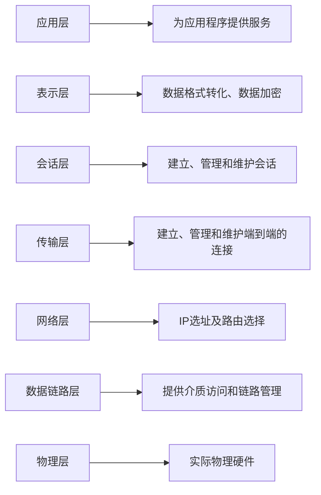

## 0、OSI七层模型

开放式系统互联（OSI）是一种概念模型，由国际标准化组织提出，一个试图使各种计算机在世界范围内互连为网络的标准框架。定义于ISO/IEC 7498-1。

## 1、centos7.9

#### 1.1、OSI七层方式

#### 1.2、OSI四层方式

#### 1.3、OSI三层方式

## 2、rocky8.10

#### 2.1、OSI七层方式

#### 2.2、OSI四层方式

#### 2.3、OSI三层方式

## 3、ubuntu22.04

#### 3.1、OSI七层方式

#### 3.2、OSI四层方式

#### 3.3、OSI三层方式

