[TOC]

## 1 sda剩余空间扩容到/

先进行备份

```shell
fdisk /dev/sda
```

扩展分区

```shell
Command (m for help): d
Command (m for help): n
Select (default p): p
#剩余使用默认选项

partprobe /dev/sda
#让内核重新读取分区表

resize2fs /dev/sda1
#ext4扩展文件系统

xfs_growfs /dev/sda1
#xfs扩展文件系统
```

| 动作         | `lsblk`                                                    | `df`                                                         |
| ------------ | ---------------------------------------------------------- | ------------------------------------------------------------ |
| 扩展分区之前 | 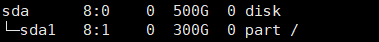 |  |
| 扩展分区     |                                                            |                                                              |
| 扩展分区之后 | 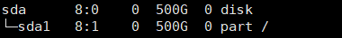 |    |

| 动作             | `lsblk`                                                    | `df`                                                       |
| ---------------- | ---------------------------------------------------------- | ---------------------------------------------------------- |
| `xfs_growfs`之前 |  |  |
| `xfs_growfs`     |                                                            |                                                            |
| `xfs_growfs`之后 |  |  |

## 2 sda sdb剩余空间合并挂载到/data

先对sda剩余空间进行分区

```shell
fdisk /dev/sda
```

```shell
Command (m for help): n
Select (default p): p
```

剩余使用默认选项

```shell
partprobe /dev/sda
#内核读取分区表
```

使用lvm实现

```shell
yum install -y lvm
```

```shell
pvcreate /dev/sda2 /dev/sdb

vgcreate vg_data /dev/sda2 /dev/sdb

lvcreate -l +100%free -n data vg_data

mkfs.ext4 /dev/vg_data/data
```

| 动作         | `lsblk`                                                      |                            `df`                            |
| ------------ | ------------------------------------------------------------ | :--------------------------------------------------------: |
| 新建分区之前 | 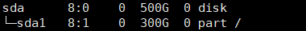   | 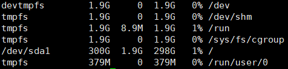 |
| 新建分区     |                                                              |                                                            |
| 新建分区之后 | 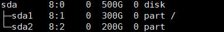   |  |
| 创建PV之前   | 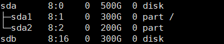   |  |
| 创建PV       |                                                              |                                                            |
| 创建PV之后   |  |  |
| 创建VG之前   |  |  |
| 创建VG       |                                                              |                                                            |
| 创建VG之后   |  |  |
| 创建LV之前   |  |  |
| 创建LV       |                                                              |                                                            |
| 创建LV之后   | 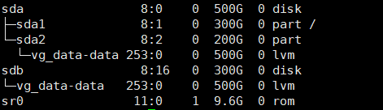   |  |
| `mkfs`之前   |    |  |
| `mkfs`       |                                                              |                                                            |
| `mkfs`之后   |    |  |
| 挂载前       |    |  |
| 挂载         |                                                              |                                                            |
| 挂载后       | 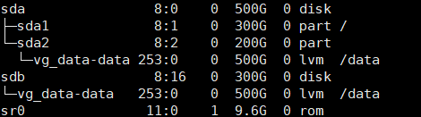   | 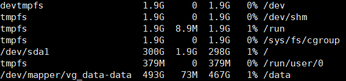 |

挂载并写入`/etc/fstab`

检验

## 3、基于lvm分区，sda剩余空间扩容到/

新建centos 使用lvm分区，/大小300g，快照

先对sda剩余空间进行分区

```shell
fdisk /dev/sda
```

```shell
Command (m for help): n
Select (default p): p
```

剩余使用默认选项

```shell
partprobe /dev/sda
#内核读取分区表
```

将新分区加入PV，扩容VG，扩容LV

```shell
pvcreate /dev/sda3
#创建PV

vgextend centos /dev/sda3
#扩容VG

lvextend -l +100%free /dev/centos/root
#扩容lV
```

扩展文件系统

```shell
df -T
#查看文件系统 

resize2fs /dev/centos/root
#扩展文件系统

df -h
#验证
```

| 动作             | `lsblk`                                                      |                            `df`                            |
| ---------------- | ------------------------------------------------------------ | :--------------------------------------------------------: |
| 新建分区之前     | 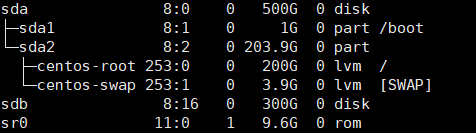   | 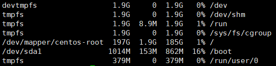 |
| 新建分区         |                                                              |                                                            |
| 新建分区之后     | 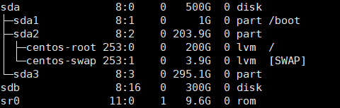   |  |
| 创建PV之前       |    |  |
| 创建PV           |                                                              |                                                            |
| 创建PV之后       |    |  |
| 扩展VG之前       |    |  |
| 扩展VG           |                                                              |                                                            |
| 扩展VG之后       | 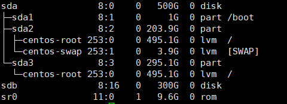 |  |
| 扩展LV之前       |  |  |
| 扩展LV           |                                                              |                                                            |
| 扩展LV之后       |    | 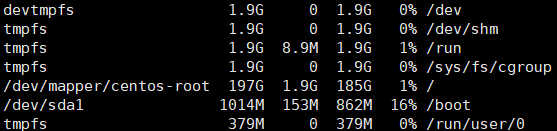 |
| 扩展文件系统之前 |    |  |
| 扩展文件系统     |                                                              |                                                            |
| 扩展文件系统之后 |    | 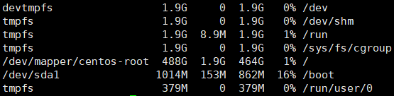 |

## 4、基于lvm分区，sda sdb剩余空间合并挂载到/data

对sda剩余空间进行分区

```
Command (m for help): n
Select (default p): p
```

剩余使用默认选项

```shell
partprobe /dev/sda
#内核读取分区表
```

将新分区与硬盘加入PV，创建VG，创建LV并格式化与挂载

```shell
pvcreate /dev/sda3 /dev/sdb
#创建PV

vgcreate data /dev/sda3 /dev/sdb
#创建VG

lvcreate -l +100%free -n data data
#创建lv

mkfs.ext4 /dev/data/data
#格式化为ext4
```

挂载到`/data`上

将配置写入`/etc/fstab`中实现开机自动挂载

| 动作         | `lsblk`                                                      |                             `df`                             |
| ------------ | ------------------------------------------------------------ | :----------------------------------------------------------: |
| 新建分区之前 |    |    |
| 新建分区     |                                                              |                                                              |
| 新建分区之后 |    |    |
| 创建PV之前   |    |    |
| 创建PV       |                                                              |                                                              |
| 创建PV之后   |    |    |
| 创建VG之前   |    |    |
| 创建VG       |                                                              |                                                              |
| 创建VG之后   |    |    |
| 创建LV之前   |    |    |
| 创建LV       |                                                              |                                                              |
| 创建LV之后   | 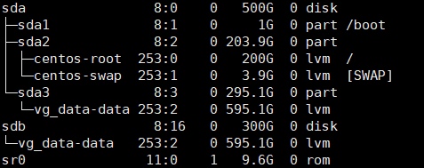   |    |
| `mkfs`之前   |  |    |
| `mkfs`       |                                                              |                                                              |
| `mkfs`之后   |  |    |
| 挂载之前     |  |    |
| 挂载         |                                                              |                                                              |
| 挂载之后     | 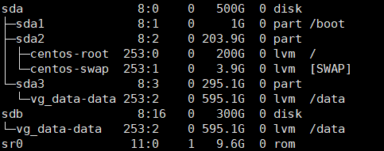   |  |

## 5、基于lvm分区将sda sdb的所有空间分配到/

对sda剩余空间进行分区

将新分区与硬盘加入PV，创建VG，创建LV并格式化与挂载

```shell
pvcreate /dev/sda3 /dev/sdb
#创建PV

vgextend centos /dev/sda3 /dev/sdb
#扩容VG

lvextend -l +100%free /dev/centos/root
#扩容lV
```

扩展文件系统

```shell
df -T
#查看文件系统

resize2fs /dev/sda1
#ext4扩展文件系统

df -h
lsblk
#查看容量
```

| 动作             | `lsblk`                                                      |                            `df`                            |
| ---------------- | ------------------------------------------------------------ | :--------------------------------------------------------: |
| 新建分区之前     |    |  |
| 新建分区         |                                                              |                                                            |
| 新建分区之后     |    |  |
| 创建PV之前       |    |  |
| 创建PV           |                                                              |                                                            |
| 创建PV之后       |    |  |
| 扩展VG之前       |    |  |
| 扩展VG           |                                                              |                                                            |
| 扩展VG之后       |    |  |
| 扩展LV之前       |    |  |
| 扩展LV           |                                                              |                                                            |
| 扩展LV之后       |    |  |
| 扩展文件系统之前 | 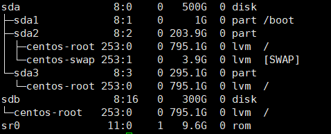 |  |
| 扩展文件系统     |                                                              |                                                            |
| 扩展文件系统之后 |  | 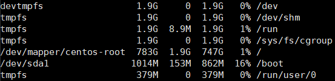 |

## 6、画图理解磁盘置备的三种模式

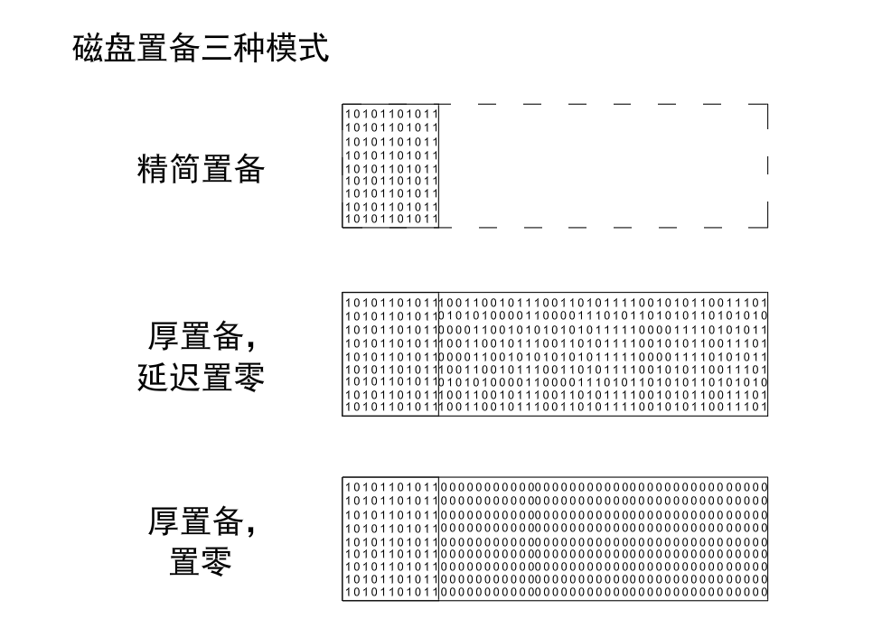

## 7、画图理解lvm工作原理

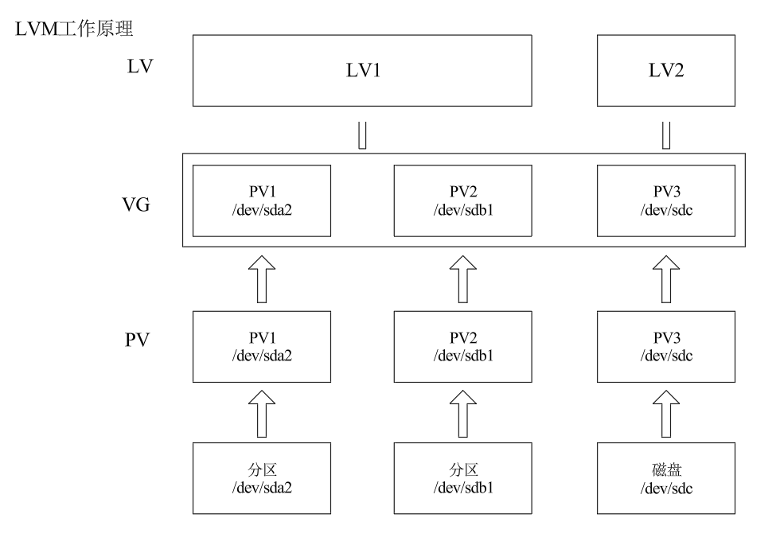

ps：可能会有小容量boot分区，忽略

xfs不支持缩容，ext4支持但是不建议缩容操作

## 8、Ubuntu网卡配置文件编辑优化

ubuntu最小化安装没有文本编辑器，借助其他linux机器实现编辑网卡配置文件并传输回ubuntu

使用ip命令实现ubuntu简易ip地址与路由配置

```bash
ip link

ip link set ens34 up

ip a add 100.100.129.91/24 dev ens34
```

使用ssh实现


## 9、`su -`与`sudo -i`

`su -` 表示切换到 root 用户并加载 root 的完整登录环境

`sudo -i` 表示以 root 身份登录,同样会获得 root 的登录shell和环境。

`su -`需要root密码，Ubuntu默认root没有密码

`sudo -i`需要当前用户密码

## 10、centos、rocky、ubuntu默认分区大小

#### centos7.9：

| 磁盘大小\目录大小 | `/boot` | `/`  | `/home` | `SWAP` |
| :---------------: | :-----: | :--: | :-----: | :----: |
|        50G        |   1G    | 47G  |    0    |   2G   |
|       100G        |   1G    | 50G  |  45.1G  |  3.9G  |
|       200G        |   1G    | 50G  | 145.1G  |  3.9G  |
|       500G        |   1G    | 50G  | 445.1G  |  3.9G  |
|        1T         |   1G    | 50G  | 969.1G  |  3.9G  |

#### rocky8.10：

| 磁盘大小\目录大小 | `/boot` | `/boot/efi` |  `/`  | `/home`  | `SWAP` |
| :---------------: | :-----: | :---------: | :---: | :------: | :----: |
|        50G        |   1G    |    600M     | 44.5G |    0     |   4G   |
|       100G        |   1G    |    600M     | 63.5G |   31G    |   4G   |
|       200G        |   1G    |    600M     |  70G  |  124.5G  |   4G   |
|       500G        |   1G    |    600M     |  70G  | 424.5.1G |   4G   |
|        1T         |   1G    |    600M     |  70G  |  948.5G  |   4G   |

#### ubuntu22.04：

| 磁盘大小\目录大小 | `/boot` | `/boot/efi` |  `/`  |
| :---------------: | :-----: | :---------: | :---: |
|        50G        |   1G    |     2G      | 23.5G |
|       100G        |   1G    |     2G      | 48.5G |
|       200G        |   1G    |     2G      | 98.5G |
|       500G        |   1G    |     2G      | 100G  |
|        1T         |   1G    |     2G      | 100G  |
